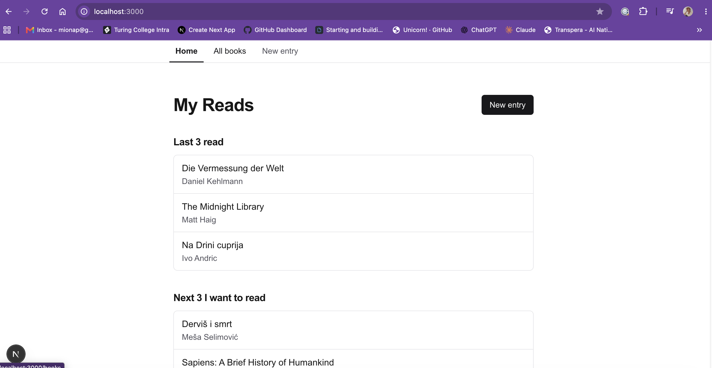

# My Reads

A small reading list that runs in your browser. Add books, note where each one comes from (Owned, Borrowed or Library) and its language, and mark each as Want to read, Reading or Read. You can edit and delete books, and everything stays saved after a reload or after closing and reopening the tab.



<!-- Add a screenshot of the app at docs/screenshot.png -->

## Pages

| Address | What it does |
| --- | --- |
| `/` | Home: "New entry" button, the last 3 books read, and the next 3 books to read |
| `/books` | All books, each linking to its own page |
| `/books/new` | Add a book (title is required) |
| `/books/[id]` | View, edit or delete one book. Unknown ids show a "book not found" message |

## Run it locally

```bash
npm install
npm run dev
```

Then open [http://localhost:3000](http://localhost:3000).

Other commands: `npm run lint` and `npm run build`.

## Stack

- Next.js (App Router)
- TypeScript
- Tailwind CSS

No backend, no accounts and no extra packages.

## Where data is saved

Books are saved in your browser's `localStorage`, as one JSON array under the key `my-reads:books`. The data stays on your machine, in the browser you used, so another browser or a private window will show an empty list. Clearing site data removes the books. The reasons for choosing `localStorage` over IndexedDB, cookies and the File System Access API are in [`docs/storage-decision.md`](docs/storage-decision.md). The book fields are in [`docs/data-model.md`](docs/data-model.md).

## Project notes

- [`AGENTS.md`](AGENTS.md): instructions for the coding agent (app details and rules)
- [`PLAN.md`](PLAN.md): the step-by-step backlog the app was built from
