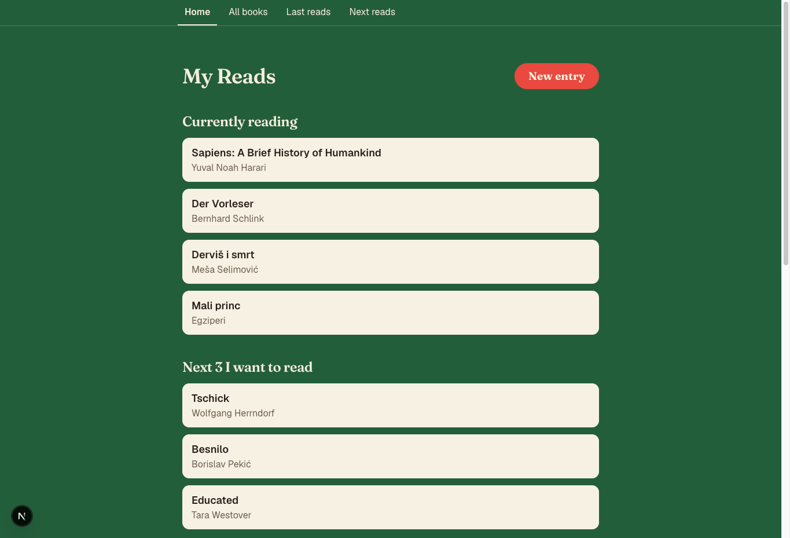
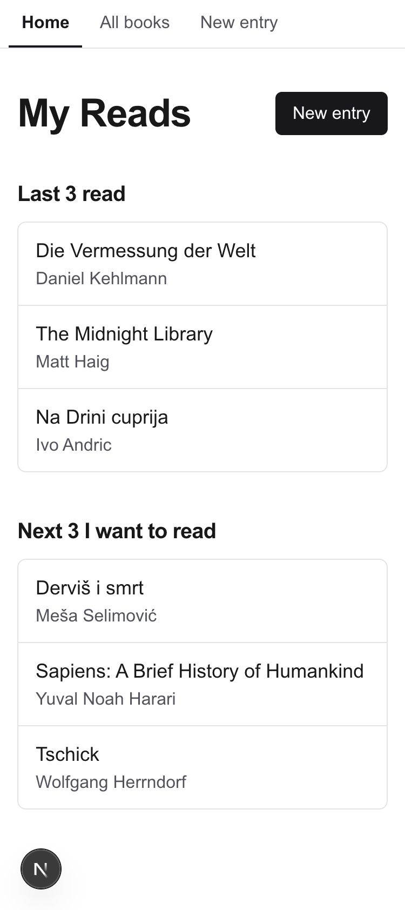

# My Reads

A small reading list that runs in your browser. Add books, note where each one comes from (Owned, Borrowed or Library) and its language, and mark each as Want to read, Reading or Read. You can edit and delete books, and everything stays saved after a reload or after closing and reopening the tab.

<table>
  <tr>
    <td align="center" valign="top">
      <br>
      <sub>Desktop, light mode</sub>
    </td>
    <td align="center" valign="top">
      <br>
      <sub>Phone, dark mode</sub>
    </td>
  </tr>
</table>

## Pages

| Address | What it does |
| --- | --- |
| `/` | Home: "New entry" button, Currently reading (all Reading books), the next 3 to read and the last 3 read, each with a "See all" link |
| `/books` | All books, each linking to its own page |
| `/books/read` | All books with status Read, newest first |
| `/books/next` | All books with status Want to read, newest first |
| `/books/new` | Add a book (title is required) |
| `/books/[id]` | View, edit or delete one book. Unknown ids show a "book not found" message |
| any other address | A friendly "Page not found" page with a link back home |

A header on every page links to Home, All books, Last reads and Next reads.

## Design

A green page with a reading-corner picture pinned to the bottom, cream book cards, coral buttons, Fraunces headings and Geist text. It follows your computer's light or dark setting: dark mode uses a darker green and a night version of the picture. Light mode is day and dark mode is evening. The choices are in [`docs/brand-guide.md`](docs/brand-guide.md).

## Run it locally

```bash
npm install
npm run dev
```

Then open [http://localhost:3000](http://localhost:3000).

Other commands: `npm run lint` and `npm run build`.

## Stack

- Next.js (App Router)
- TypeScript
- Tailwind CSS

No backend, no accounts and no extra packages.

## Where data is saved

Books are saved in your browser's `localStorage`, as one JSON array under the key `my-reads:books`. The data stays on your machine, in the browser you used, so another browser or a private window will show an empty list. Clearing site data removes the books. The reasons for choosing `localStorage` over IndexedDB, cookies and the File System Access API are in [`docs/storage-decision.md`](docs/storage-decision.md). The book fields are in [`docs/data-model.md`](docs/data-model.md).

Each book also records `statusChangedAt`, the moment it was added or its status last changed. Lists are sorted newest first by that date, so a book you just marked Read appears at the top of the Read lists.

## Project notes

- [`AGENTS.md`](AGENTS.md): instructions for the coding agent (app details and rules)
- [`PLAN.md`](PLAN.md): the step-by-step backlog the app was built from
